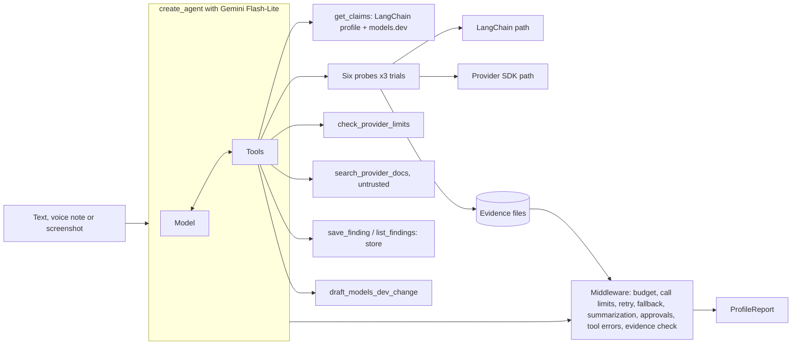

# Claimcheck

For developers who trust LangChain model profiles, Claimcheck removes the guesswork about whether a model can really do what its profile says.

A LangChain agent reads what the LangChain profile and [models.dev](https://github.com/anomalyco/models.dev) claim about a model, runs probes with known answers three times each, and reports every claim as sealed (confirmed), rejected (contradicted), on hold (inconclusive), unclaimed, or not tested. Each verdict links to the transcripts behind it. When models.dev is wrong, it drafts a correction for a person to review. It never submits anything.

- Live app: see [Deploy](#deploy).
- Part of a small agent reliability series with Pause and Shakedown.

## Why

LangChain agents make runtime choices from model profile data, such as the structured output strategy and summarization triggers. LangChain's docs say that data "can be missing, stale, or incorrect", and fixes go upstream as pull requests to models.dev. Claimcheck tests the claims instead of trusting them.

One real example, found on 29 Sep 2026: `langchain-google-genai` 4.4.0 was released on 1 Sep and has no profile at all for `gemini-3.8-flash`, which models.dev lists from 2 Sep.

## How it works



LangChain features used, and why:

| Feature | Use |
|---|---|
| `create_agent` | One agent, 12 tools, configured in `src/claimcheck/agent.py`. |
| `init_chat_model` | The only place a model is made (`models.py`), for the agent and for probe targets. |
| `ToolStrategy(ProfileReport)` | Typed final report. Set explicitly because some Gemini profiles are empty, so automatic strategy selection has nothing to read. |
| Checkpointer (`SqliteSaver`) | Short-term memory per `thread_id`, so "now check image input for the same model" works. |
| Store (`SqliteStore`) | Saved findings, so a later run shows what changed. |
| `HumanInTheLoopMiddleware` | Saving a finding and drafting a models.dev change wait for approve, edit or reject. |
| `ModelCallLimitMiddleware`, `ToolCallLimitMiddleware` | Hard caps per run. |
| Custom `BudgetMiddleware` | Token and wall clock budget per run, and a daily cap shared with the probes. Stops cleanly and says what finished. |
| `ModelRetryMiddleware`, `ModelFallbackMiddleware` | Backoff on 429 and 503, then a second Flash-Lite model. |
| `SummarizationMiddleware` | Keeps long threads under budget. |
| `ToolErrorMiddleware` | A bad tool call becomes an error message to the model, not a crashed run. |
| Custom `EvidenceCheckMiddleware` | After the agent answers, reloads every cited transcript and recomputes each verdict in code. |
| `InMemoryRateLimiter` | Paces calls to stay inside free-tier request rates. |
| Content blocks | Images and audio go to Gemini as standard `image` and `audio` blocks. Audio is sent as audio, with no separate transcription. |
| Stream modes `updates`, `messages`, `custom` | Drive the live trace in the web app, including each probe trial. |

### The probes

| Probe | Sent | Passes when |
|---|---|---|
| Tool calling | "What is the weather in Paris right now? Use the get_weather tool." | `get_weather` is called with Paris |
| Forced tool choice | An unrelated question with `tool_choice="add_numbers"` | `add_numbers` is called |
| Parallel tool calls | Weather for Paris and Tokyo in one response | both cities in one message |
| Native structured output | A sentence about Dune with a JSON schema, `method="json_schema"` | title, author and year parse exactly |
| Image input | A PNG drawn locally with a word, a number and a colored circle | all three read back |
| Audio input | A clip of five digits, synthesized offline | digits match exactly |

Transient errors (429, 503) count as errors, not failures. A provider refusal such as "Audio input modality is not enabled for this model" counts as a failure, because it is a real answer about the capability. When a result disagrees with a claim, the agent runs the same probe through the `google-genai` SDK directly. A pass there and a fail through LangChain points at the integration. Token limits come from the provider's model metadata endpoint, never from oversized prompts.

## Web app

`web/` is a Next.js app with two pages. The landing page shows a real recorded report, sealed claim by claim, and every gauge chamber opens its transcript. The inspection bench takes text, a screenshot (drag and drop, or the camera on a phone) or a voice note with a live waveform. It streams a report sheet, a log of every model call, tool call, probe trial, middleware step and approval, and a limits panel with the budget left. Approvals are answered in place with approve, edit or reject. When the API is asleep, the bench replays the recorded run instead, labeled as recorded.

Lighthouse on the landing page, production build served locally on 29 Sep 2026: desktop 99 performance, 100 accessibility, 100 best practices, 100 SEO. Mobile scores 100 for accessibility, best practices and SEO, but only 76 to 83 for performance over three runs, below the 90 I aimed for. Most of the remaining cost is React hydration and layout under the simulated slow phone.

## Limits and safety

- Per run: 25 model calls, 40 tool calls, 400,000 tokens, 600 seconds. Per day: 400 provider calls. All set in `.env`.
- Per address: 10 live runs an hour on the API.
- Approvals: saving a finding and drafting a models.dev change.
- Drafts only: nothing is posted, submitted or emailed.
- Untrusted content: search results are wrapped and labeled, and the prompt says to ignore instructions inside them, in screenshots and in audio. Eval cases cover an injected search result and an injected screenshot.
- Honest outputs: the evidence check drops invented evidence ids, corrects copied values, fills in fields the report left out, and recomputes verdicts. Every change is listed on the report.
- Keys stay in `.env` on the server. The browser only receives events, reports and evidence.

## Eval results

16 cases in `evals/dataset.jsonl`: easy, ambiguous and adversarial, including "inconclusive" and "no problem" answers and two injection cases. The agent model is called live. Probe results, limits, search results and the models.dev catalog replay from recordings of real runs, so every case sees the same evidence.

Latest run, 29 Sep 2026: **14 of 16 passed.** Two cases fail:

- `off-topic`: asked "Which model is best for writing code?", the agent picked a model and probed it instead of asking which one.
- `false-claim-probed`: asked about "Gemma 4 26B", the agent got a close match back from `get_claims` and, following its rule for unknown ids, stopped to ask for the exact id instead of probing. The case expects it to probe `gemma-4-26b-a4b-it`. The previous run, before that rule, passed 15 of 16 with this case passing.

Full table and every correction the evidence check made: [evals/RESULTS.md](evals/RESULTS.md).

## Setup

Needs Python 3.12 with [uv](https://docs.astral.sh/uv/), Node 22, a free [Google AI Studio key](https://aistudio.google.com/apikey) and a free [Tavily key](https://app.tavily.com).

```bash
cp .env.example .env            # then add GOOGLE_API_KEY and TAVILY_API_KEY
uv sync && uv run python check_env.py
uv run uvicorn claimcheck.api.app:app --port 8000
cd web && npm install && npm run dev
```

Then open http://localhost:3000. Tests: `uv run pytest`. Evals: `uv run python evals/run.py`. One investigation from the terminal: `uv run python -m claimcheck.cli "Inspect google gemini-3.5-flash-lite" --thread t1`.

## Deploy

- API: on [Render](https://render.com), choose New, then Blueprint, and pick this repository. `render.yaml` sets up a free Docker web service. Fill in `GOOGLE_API_KEY`, `TAVILY_API_KEY` and `PROXY_SECRET` (any long random string). The free service sleeps after 15 minutes idle, and saved findings reset when it restarts.
- Web: deploy `web/` on Vercel and set `API_UPSTREAM` to the Render URL and `PROXY_SECRET` to the same string. The browser only talks to the Vercel site. Its `/api` route forwards calls to the API and passes the visitor's address for rate limiting.
- When the API is asleep or out of quota, the web app plays the recorded run in `web/public/demo`.

## Known limitations

- Only Google is in scope, because only its free tier was available. Other providers are reported as out of scope.
- Flash models allow 20 requests a day on the free tier, so the agent runs on Flash-Lite and a full inspection of a Flash model uses its whole daily quota.
- No real contradicted models.dev claim has been found yet, so no real draft exists.
- `off-topic` and `false-claim-probed` fail, see above.
- The agent often calls `save_finding` twice in one step. The second call overwrites the first and costs one approval.
- LangSmith tracing is wired through env vars but has not been run with a real key.

## What I would build next

- More providers through free tiers such as Groq and OpenRouter.
- A scheduled re-check that opens a draft when a claim that used to hold starts failing.
- Probes for streaming tool calls and reasoning output, which profiles also claim.

## License

MIT
